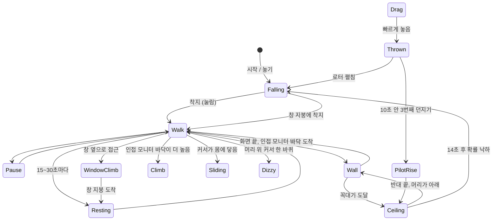

# 데스크톱 펫 로밍 도입 계획 (치이카와 벤치마크)

작성일: 2026-10-21 · 검토 기준: 로컬 체크아웃 `214cc12`

## 1. 결론

지금 펫은 **작업 표시줄 위의 한 줄**을 좌우로 걷다가 앉는 것이 전부다. 치이카와 프로그램의 핵심은 아트가 아니라 **"화면 전체를 하나의 지형으로 다룬다"**는 점이다. 바닥 끝에 닿으면 벽을 타고, 꼭대기에서 천장으로 건너가고, 반대편 벽을 머리부터 내려오며, 열린 창의 옆면을 올라 지붕 위를 걷는다. 던지면 날아가고, 놓으면 낙하하고, 커서에 반응한다.

이 계획은 그 구조를 다음 세 가지로 옮긴다.

1. **움직임 엔진을 UI에서 분리한다.** 지금 `DesktopPetWindow.xaml.cs`(약 57KB)에 걷기/쉬기가 박혀 있다. 지형·상태·전이를 순수 C#으로 `DeskNote.Companion.Core`에 두고, 가짜 월드로 결정론적으로 테스트한다. 치이카와도 같은 이유로 `IWorld`/`TestProvider`/`TestMouse` 이음새를 두고 338개 자체 검증을 돌린다.
2. **새 그림을 거의 그리지 않고 시작한다.** 치이카와의 벽·천장 포즈는 걷기 프레임을 회전/뒤집어 만든 것이다. 이 저장소는 이미 "그리지 말고 기존 그림에서 계산한다"(`build_sleep_sprites.py`)와 "소품은 벡터로"라는 원칙이 있어 그대로 맞는다.
3. **이 앱의 고유한 의미를 움직임에 싣는다.** 배고픔은 우는 얼굴로, 메모 알림은 달려오는 펫으로, 숨은 동작의 발견은 기억 앨범 카드로 연결한다. 치이카와의 간식/친밀도/도우미 창을 복제하는 것이 아니라, 이 앱에 이미 있는 돌봄·성장·알림 위에 움직임을 얹는다.

가장 큰 기술 위험은 **고정 240×250 투명 창이 화면 가장자리·천장에서 클릭을 가로막는지**와 **서로 다른 DPI 모니터를 건널 때 창 크기가 바뀌는지**다. 그래서 첫 단계(M0)는 기능이 아니라 이 두 가지를 확인하는 스파이크다.

## 2. 분석 범위와 원칙

- 분석 대상: `전주치이카와_2.08.exe`(32비트 .NET Framework WinForms, 6.5MB), `전주치이카와_움직임.ini`, 실행기록.
- 방법: **정적 분석만 했다.** exe를 실행하지 않았다. exe가 리소스로 내장한 `source/*.cs`와 `README.txt`, 설정 파일을 읽어 동작 규칙과 수치를 확인했다. 화면에서 직접 관찰한 것이 아니므로 체감(속도감, 부드러움)은 도입 후 튜닝으로 맞춘다.
- **복제하지 않는다.** 치이카와는 원작 캐릭터 이미지를 쓰는 팬 제작물이다. 스프라이트, 대사, 이름, 소스 코드를 가져오지 않는다. 가져오는 것은 "벽→천장→반대편 벽→바닥으로 이어지는 순환", "창 꼭대기 걷기" 같은 **동작 설계와 상태 전이 아이디어**뿐이며, 구현과 아트는 이 저장소의 7종 펫과 코딩 규약으로 새로 만든다.
- 이 계획서를 쓰며 제품 코드를 바꾸거나 빌드·테스트를 실행하지 않았다.

## 3. 치이카와가 하는 일

### 3.1 구성

| 항목 | 내용 |
|---|---|
| 창 | 펫 한 마리당 투명 레이어드 창 하나(`UpdateLayeredWindow`, 픽셀 단위 알파). 매 틱 프레임을 그려 창에 올린다 |
| 틱 | 타이머 한 개. `dt`는 0.1초로 상한. 창 목록은 0.35초마다, 화면/잠금 상태는 1초마다 갱신 |
| 상태 | 24개(§부록 A). 상태 하나가 이동 규칙, 그림, 지속시간을 모두 결정 |
| 지형 | 모니터 작업 영역들의 목록(`Areas`) + 열린 최상위 창들(`DesktopSurfaces`) |
| 센서 | 커서 위치/버튼, 전체화면 여부, 사용자 입력 유휴 시간, 세션 잠금·화면보호기 |
| 설정 | `.ini` 한 장. `Walls/Ceiling/Windows/Idle/Escape/Follow/Focus/WorkFocus/Fullscreen/Secrets/...`와 속도 3종 |

### 3.2 상태 전이



### 3.3 "구석구석 다닌다"의 비결 다섯 가지

1. **화면 끝이 곧 벽 입구다.** 바닥을 걷다가 끝에 닿으면 반사하지 않고 `Wall`로 들어간다. 단, 그 끝 바로 너머에 같은 높이의 다른 모니터가 이어져 있으면 벽이 아니라 그냥 건너간다.
2. **벽→천장→벽→바닥이 한 바퀴로 닫혀 있다.** 올라갈 때는 머리 위로, 천장에서는 가로로(방향=올라온 반대쪽), 반대편 벽은 머리가 아래로 내려온다. 막다른 길이 없어서 어디서든 다음 행동이 있다.
3. **높이가 다른 모니터는 Climb으로 오른다.** 이웃 모니터의 바닥이 지금 바닥보다 위에 있으면 그 단차를 오른다. 낮으면 걸어가다 떨어진다(`Falling`).
4. **열린 창이 지형이 된다.** 창 목록에서 윗변이 화면 중간쯤에 있는 창을 고르고, 좌우 중 여유 있는 쪽 옆으로 걸어가 올라타고, 지붕에서 5~10초 쉬고 걷는다. 창이 움직이면 같이 움직이고, 닫히거나 가려지거나 끝을 넘으면 떨어진다.
5. **타이머로 흩뿌린 의지.** 쉬기(15~30초), 창 오르기(처음 25~45초, 이후 35~65초), 다음 도망(2.5초 쿨다운)이 각자 무작위 간격의 "다음 시각"을 들고 있다. 한 상태가 끝날 때마다 `DelayIdle`로 다른 의지들을 밀어서 동시에 터지지 않게 한다.

### 3.4 움직임 수치 (치이카와 기준)

| 동작 | 값 | 비고 |
|---|---|---|
| 걷기 | 34·S px/s, 3~10초 | S=화면 배율. 끝에서 40% 확률로 멈춤 |
| 멈춤 | 1.2~4.2초 | 35% 확률로 방향 전환 |
| 벽 오르기 | 42·S (걷기의 1.24배) | 내려올 때 같은 속도, 머리가 아래 |
| 천장 기기 | 36·S (1.06배) | 14초 후 초당 8% 확률로 낙하 |
| 창 옆 오르기 | 46·S (1.35배) | 오르는 몸 높이의 55%가 윗변을 넘으면 지붕으로 올라섬 |
| 모니터 단차 오르기 | 30·S | |
| 슬라이딩(도망) | 210·S (6.2배), 0.7~0.95초 | 커서가 0.12초 이상 몸에 머물면 발동, 쿨다운 2.5초 |
| 쉬기 | 20~30초(짧게 6~11초) | 배고프면 우는 앉기 2.4~3.4초 |
| 헬리콥터 낙하 | 35~95·S px/s × FallSpeed(기본 1.2) | 가속 55·S, 던진 가로 속도는 지수 감쇠 |
| 던지기 | 놓기 직전 0.12초 표본, 300·S 이상일 때만, 최대 1600·S의 70% | 중력 900·S, 비행 0.45~0.6초 뒤 로터 펼침 |
| 비밀 조종사 상승 | 185·S | 10초 안에 세 번째 던지기 |
| 어질어질 | 머리 위에서 같은 방향 2π−0.18 rad, 6초 이내, 쿨다운 20초, 4초 지속 | 원을 그린 곡률(>π)까지 확인해 직선 휘두름과 구분 |

### 3.5 반응과 숨은 동작

- **클릭 반응 3종**(눌림, 달달 떨며 울기, 폴짝)을 순환/무작위/하나만/끔으로 고른다. 벽·천장·창 위에서 클릭하면 반응 대신 헬리콥터로 내려온다.
- **커서 반응**: 접근하면 슬라이딩으로 도망(기본 켬), `Follow`는 커서 쪽으로 걷기. 화면 가장자리에서는 도망 방향을 안쪽으로 바꾼다.
- **숨은 동작 3종**: 어질어질(커서 원 그리기), 몰래 군무(펫 둘 이상, 커서가 4초 떨어져 있을 때), 비밀 조종사(10초 안 3번 던지기). 발견 여부를 저장해 "발견한 비밀 n/3"으로 보여준다.
- **살아있는 느낌**: 앉은 몸의 호흡, 우는 얼굴의 미세 떨림, 말풍선, 배고픔 표정이 만성적으로 유지됨.

### 3.6 주변 기능과 품질 장치

- 사용자 입력이 N분 없으면 낮잠, 입력이 돌아오면 기상. 점심/퇴근 시각에는 한곳에 모여 환호. 정각 알림 카드와 화면 가장자리 빛.
- 평일 9~18시 자동 얌전 모드(바닥만, 도망 없음), 전체화면 영상·게임이면 자동 숨김, 잠금·화면보호기에서 일시정지, "화면 가운데로 다시 부르기"(분실 구제), 위치 고정, 캐릭터 투명도.
- 우클릭 **"동작 바로 보기"** 메뉴로 각 동작을 즉시 재생. 결과: 기능 발견과 수동 검증이 같은 장치로 해결된다.
- 키보드/마우스 전역 후크를 설치해 "활동 시간"을 센다. → **도입하지 않는다**(§5).

## 4. 현재 프로젝트와의 격차

| 영역 | 현재 (`DesktopPetWindow`) | 치이카와 |
|---|---|---|
| 지형 | 현재 모니터 작업 영역의 좌우 폭 한 줄. `Clamp`로 가둠 | 모든 모니터 작업 영역 + 열린 창 |
| Y축 | 고정(`_y`는 시작 때 정한 값, 드래그 때만 변함) | 중력, 낙하, 상승, 비행 |
| 상태 | 걷기/쉬기 2개 + 쉬기 자세 4개 | 24개 |
| 모양 변형 | 균일 확대 + 발끝 기준 회전(`PoseRotation`, `FacingTransform`) | 회전/뒤집기/그림 교체로 벽·천장·낙하 |
| 입력 | 클릭=대시보드, 더블클릭=새 메모, 드래그=이동 | + 던지기, 커서 근접, 원 그리기 |
| 창 다루기 | `FindCoveringWindow`, `IsCloaked`, `IsShellSurface`, `FillsItsDisplay` 이미 있음 | 같은 계열 API를 지형 판정에 사용 |
| 구조 | 약 57KB 단일 파일, 타이머 6개 | 상태 기계가 UI와 분리 |
| 시험 | 움직임 단위 시험 없음 | 월드 가짜 구현으로 90개+ 시나리오 |

격차 중 **창 관련 Win32 보조 코드가 이미 있다**는 점이 크다. `EnumWindows` 기반 `DesktopSurfaces`를 새로 쓰되 `IsCloaked`/`IsShellSurface`/`FillsItsDisplay`는 그대로 `Services`로 옮겨 재사용한다.

## 5. 도입 판단표

| 치이카와 요소 | 판단 | 이 프로젝트에서의 형태 |
|---|---|---|
| 벽 타기 / 천장 타기 / 벽 하강 순환 | **채택** | M1. 걷기 프레임 회전 파생 포즈로 시작 |
| 모니터 가장자리 판정(인접 모니터면 벽 아님) | **채택** | M1. `MonitorLayout.All()`에서 인접 판정 |
| 높이 다른 모니터 단차 오르기 | **채택** | M1 후반. 작업 영역이 겹치지 않는 구성 위주 |
| 던지기(속도 표본, 비행) | **채택** | M1. 기존 드래그 로직 위에 속도 추정 |
| 낙하 연출(헬리콥터) | **변형** | 같은 그림은 못 쓴다. 벡터 소품(잎 우산/프로펠러)으로 시작, 용은 날개 활공. "소품은 벡터" 원칙 |
| 창 오르기 / 창 지붕 걷기 / 창 따라 이동 | **채택** | M2. 활동 레벨 "활발"에서만 |
| 커서 도망(슬라이딩) | **변형** | 기본 꺼짐. 업무 도구에서 클릭 대상이 도망가면 안 됨. "활발"에서 선택 가능 |
| 커서 따라오기 | **채택(옵션)** | M2. 기본 꺼짐 |
| 커서를 쳐다보기 | **신규 제안** | 치이카와엔 없음. 가장 값싼 "살아있음" 신호. 기본 켬(M2) |
| 어질어질 (커서 원 그리기) | **채택** | M4. 도감에 기록 |
| 비밀 조종사 (3번 던지기→천장) | **변형** | M4. 종별 연출(용=비행, 나머지=풍선) |
| 몰래 군무 (펫 2마리) | **보류** | 펫은 한 마리. 다마리 지원 시 재검토 |
| 클릭 반응 3종 | **변형** | 클릭=대시보드가 이미 있어서 §10-1로 확정: 반응은 즉시 재생, 대시보드 동작은 기존 유지(M3) |
| 우는 얼굴(배고픔) | **채택** | M3. 눈물 오버레이(벡터)+미세 떨림. `NeedKey()`가 이미 포만감/청결/기분을 구분 |
| 낮잠(입력 유휴) | **채택** | M3. `GetLastInputInfo`만 사용. 이미 만든 `-sleep` 시트 활용 |
| 점심/퇴근 모여서 환호 | **변형** | M3. "메모 알림이 울리면 펫이 화면 가운데로 달려와 말풍선" |
| 정각 알림 카드 + 가장자리 빛 | **제외** | 이 앱은 알림 토스트가 있다. 시각 효과는 가치 대비 범위가 큼 |
| 도우미(할 일/메모/타이머) | **제외** | 이 앱 자체가 메모/체크리스트/알림 |
| 친밀도 숫자, 꽃다발, 간식 | **제외** | 유대감·성장 단계·돌봄 시스템이 이미 있음 |
| 얌전 모드 / 업무시간 자동 얌전 | **채택** | M0~M3. 활동 레벨 설정 + 조용한 시간대와 연동(§6.5) |
| 전체화면 자동 숨김 | **확인 후 보완** | 지금은 "전체화면 위로 올리지 않기"까지만. 숨김은 M3에서 결정 |
| 잠금·화면보호기 일시정지 | **채택** | M0. 안정성 항목 |
| "화면 가운데로 다시 부르기" | **채택** | M0. 로밍 도입 전에 먼저 만든다. 분실 구제 장치 |
| 동작 바로 보기 메뉴 | **채택** | M0부터 동작마다 한 줄씩 추가 |
| 위치 고정 | **기존 기능에 대응** | `움직이기` 끄기(`ReduceMotion`)가 같은 역할 |
| 캐릭터 투명도 | **보류** | 요구가 생기면 창 `Opacity` 한 줄 |
| 전역 키보드·마우스 후크 | **제외 (확정)** | 메모 앱이 키 입력을 후킹하는 것은 프라이버시·백신 오탐 모두 부정적. 유휴 판정은 `GetLastInputInfo`로 충분 |
| 자체 회귀 검증 모드(`--xxx-test`) | **방식 채택** | 별도 exe 플래그 대신 Core 단위 시험 + `tools/capture-window.ps1` |

## 6. 목표 설계

### 6.1 계층

```
DeskNote.Companion.Core        순수 C#. WinUI/Win32 모름
  Motion/
    PetMotionEngine            Update(dt) → PetPose
    PetMotionState             상태 열거 + 상태별 규칙
    IMotionWorld               Areas, Surfaces, Cursor, Now, Rng, IdleSeconds, Quiet
    MotionProfile              활동 레벨/속도/허용 동작 (설정에서 만든 값)
    PetPose                    X,Y, Facing, Sprite(종류, 프레임), Angle, Scale, Props(눈물/소품)
DeskNote.App/Services
  DesktopSurfaces              EnumWindows + DWM 경계 + 가려짐 판정 (0.35초 갱신)
  MotionSensors                커서, 유휴, 잠금, 디스플레이 변경 → IMotionWorld
DeskNote.App/Views
  DesktopPetWindow             PetPose를 창 위치 + XAML 변환으로 반영만 한다
  DesktopPetWindow.Motion.cs   틱, 입력 → 엔진 이벤트(Grab, Release, Click)
```

원칙은 기존 코드와 같다. `CompanionBalanceV2`가 같은 입력에 같은 출력을 내듯, **같은 월드·같은 시드·같은 시간열이면 같은 움직임**이 나와야 시험할 수 있다. 난수는 기존처럼 `_behaviour` 계열을 분리해 주입하고(`Random`), 시간은 `IClock`을 쓴다.

### 6.2 접촉 지점: 고정 창에 회전 그림을 붙이기

창이 240×250로 고정이고 펫은 그 안에서 약 20~80% 구간만 차지한다. 벽/천장에서 몸이 화면 가장자리에 닿으려면 **창이 화면 밖으로 삐져나가야** 한다(투명한 여백 부분). 치이카와의 `ContactBody`/`Bounds` 와 같은 발상으로 포즈마다 **잉크 경계(내용이 있는 최소 사각형)**를 계산해 두고, 창 위치는 "잉크가 지형에 닿도록" 역산한다.

- 현재 `Clamp`는 창 전체를 작업 영역에 가둔다 → 잉크 경계 기준으로 바꾼다.
- 잉크 경계는 시트 로드 때 한 번 계산해 포즈×종×크기로 캐시한다. `build_sleep_sprites.py`가 이미 내용 경계를 출력하는 방식이므로 같은 숫자를 `CompanionPetSprites`로 노출한다.
- **인접 모니터 쪽으로는 삐져나가지 않는다.** 투명 여백이라도 이웃 모니터에 창 일부가 놓이면 거기서 클릭을 가로막고 DPI 변경 알림도 받는다. 벽은 바깥쪽 끝에만 만든다.

### 6.3 상태 목록 (목표)

기존: `Walk`, `Rest(Sit/Sleep/Daydream/Stretch)`, `CareReaction`.

추가: `Drag`, `Thrown`, `Falling`, `Landing`(눌림), `Wall`(올라감/내려감), `Ceiling`, `WindowClimb`, `WindowTop`, `LedgeClimb`(단차), `Hop`, `Dash`(슬라이딩), `Curious`(커서 쪽 보기), `Follow`, `CryHungry`, `Dizzy`, `Summon`(알림에 달려옴), `Rocket`(비밀 비행).

전이 규칙은 §3.2를 기본으로 하되, **모든 상태에서 "내려오기" 탈출구**를 둔다. 벽·천장·창에서 클릭하면 `Falling`으로(치이카와와 같음). 지형이 사라지거나(창 닫힘, 모니터 해제) 설정이 꺼지면 즉시 `Falling`.

### 6.4 아트 전략: 세 단계

| 단계 | 방식 | 필요한 새 그림 | 쓰임 |
|---|---|---|---|
| T0 | 기존 `walk` 시트를 **회전/상하 뒤집기**로 파생 | 없음 | 벽 오르기(270°), 벽 내려오기(뒤집기), 천장 기기(상하 반전), 던져짐(기울기), 낙하(약간 늘임 금지: 비율 보존) |
| T1 | **벡터 오버레이**를 XAML로 그림 | 없음 | 눈물, 땀방울, 낙하용 잎 우산/프로펠러, 어질어질 별, 비행 고글, 하트 |
| T2 | `assets/companion`에 생성 스크립트를 두고 종별 시트 생성 | 7종 × 일부 | 웅크린 울기, 매달린 손, 활공 포즈 등 T0/T1으로 어색한 것만 |

**비율 보존 규칙을 유지한다.** `docs/companion.md`가 기록한 사고(비균일 스케일로 "울렁거림")를 반복하지 않는다. T0는 회전/반전만 쓰고, 어떤 포즈도 `ScaleX != ScaleY`가 되지 않는다. 이는 `ApplyFacingTransform`이 이미 구조적으로 막고 있으며 새 포즈도 이 함수를 통하게 한다.

### 6.5 활동 레벨과 설정

설정이 많으면 설명서가 된다. 치이카와는 `.ini`에 켬/끔 15개와 속도 3종을 노출한다. 이 앱은 **한 개의 선택 + 소수의 예외**로 줄인다.

| 레벨 | 포함 동작 |
|---|---|
| 얌전 | 바닥 걷기/쉬기만 (현재와 같음) |
| 보통 (기본, 확정) | + 벽·천장 순환, 낙하, 던지기, 낮잠, 욕구 표현 |
| 활발 | + 창 오르기/지붕 걷기, 커서 따라가기/도망, 비밀 동작 |

- 기존 `움직이기`(ReduceMotion)는 그대로 최상위 스위치다. 켜면 레벨과 관계없이 정지.
- 속도 슬라이더 1개(0.5~2.0). 치이카와는 걷기/낙하/슬라이딩 3개를 두지만, 이 앱은 한 개로 충분하다.
- **조용한 시간(`QuietStart`~`QuietEnd`)과 연동**: 지금은 선제 제안만 막는다. 로밍도 조용한 시간에는 "얌전"으로 낮추는 옵션을 둔다(치이카와의 업무시간 얌전 모드와 같은 취지, 기준 시간이 이미 있다는 점만 다르다).
- 저장은 기존 `SettingKeys.Companion*`와 같은 방식(`CompanionSettings.LoadAsync/SaveAsync`)이며 잘못된 값은 기본값으로 떨어진다. 치이카와 시험이 `Speed=Infinity`, `ClickMode=unknown`을 넣어 보는 것과 같은 경계 시험을 넣는다.

### 6.6 이 앱 고유의 연결

| 이벤트 | 움직임 |
|---|---|
| 포만감 낮음 | `CryHungry`: 눈물 오버레이 + 미세 떨림 + 말풍선 (`NeedKey()`가 이미 구분). 간식 주면 즉시 해제 |
| 청결 낮음 | 몸을 터는 동작(회전 진동). 씻기면 반짝임 |
| 기분 낮음 | 멍때리기 비율 증가(기존), 커서를 오래 쳐다보다 시선 돌림 |
| 메모 알림 발생 | `Summon`: 현재 위치에서 가장 가까운 안전한 바닥으로 내려와 알림 쪽으로 걸어오고 말풍선. 조용한 시간/집중 상태 존중 |
| 단계 성장 | 기존 `CelebrateNewStage` 위에 폴짝 + 소품 |
| 숨은 동작 발견 | **기억 앨범에 카드 1장**(템플릿 추가). 점수·XP는 없음 |
| 사용자 유휴 N분 | 낮잠 자리로 이동 후 `Sleep`. 입력이 돌아오면 `Waking` |

숨은 동작과 도감은 `gameplay-improvement-plan.ko.md`의 "발견" 보상 축과 겹친다. 같은 앨범 기반(`companion_memory_album`, `(companion_id, grant_key)`)을 쓰므로 새 저장 구조는 필요 없다. 움직임으로 XP를 주지 않는다(`docs/companion.md`의 부정 반복 방지 원칙과 같음: 클릭·드래그·자동 걷기에는 점수 없음).

## 7. 단계별 로드맵

크기는 상대값(S < M < L)이다. 각 단계는 **혼자 출하 가능**하도록 끊었고, 이전 단계의 동작을 유지한다.

### M0. 기반과 스파이크 (L)

**스파이크 (먼저, 버릴 코드로)**
1. 투명 창이 화면 가장자리·천장에서 **클릭을 막는가.** 막는다면 후보: ① 포즈별로 창 크기를 잉크 경계에 맞춘다, ② 서브클래싱으로 `WM_NCHITTEST`가 잉크 밖에서 `HTTRANSPARENT`를 반환, ③ `SetWindowRgn`을 잉크 영역으로 지정. 가장 단순하게 통과하는 것을 선택.
2. 창이 DPI가 다른 모니터 경계를 넘을 때 크기가 바뀌는가. 바뀐다면 이동 직후 물리 픽셀 크기를 다시 지정하는 규칙이 필요.
3. 30fps 타이머 + `AppWindow.Move` vs `SetWindowPos` 직접 호출의 프레임 고르기. 60fps로 올릴 가치가 있는가.
4. 창을 음수 좌표/화면 밖으로 일부 삐져나가게 했을 때 DWM이 그대로 그리는가.

**본 작업**
- `PetMotionEngine` 추출. 현재 걷기/쉬기를 **동작 변화 없이** 이식하고 기존 시험(`CompanionActivityQueueTests` 등 Core 시험 프로젝트)에 월드 가짜 구현으로 시험을 추가.
- `DesktopSurfaces`/`MotionSensors` 서비스 신설. `FindCoveringWindow`류 함수 이동.
- 우클릭 메뉴에 **"펫 불러오기"**(화면 가운데로 복귀)와 **"동작 바로 보기"** 뼈대.
- 잠금/절전/세션 전환 때 일시정지, 디스플레이 구성 변경 때 위치 보정.
- `DesktopPetWindow` 분할: `.Motion.cs`, `.Surfaces.cs`.

**완료 기준**: 스파이크 결과가 이 문서에 새 절("M0 스파이크 결과")로 기록되고 §9 위험표에 반영됨 · 동작 변화 없음(기존 걷기/쉬기 시험 통과) · 펫 불러오기가 모든 상태에서 성공 · 동작 바로 보기 메뉴가 `Walk`/`Rest*` 재생.

**진행 상태 (2026-10-21)**: 구현과 실기 확인을 마쳤다. 결과는 아래 "M0 결과"와 §9 위험표에 있다.

#### M0 결과

실제 빌드를 `--data`로 격리해 띄우고(`tools/DemoSeeder -- <폴더> --motion`), 바깥에서 Win32로 창을 읽고 조작해 확인했다. 이 PC는 1920×1080 모니터 둘(둘 다 96 DPI, 둘째가 왼쪽에 붙어 있음)이다.

| 스파이크 | 결과 |
|---|---|
| 1. 투명 영역이 클릭을 막는가 | **막는다. 지금 출하된 창도 마찬가지다.** `WindowFromPoint`로 재면 240×250 전체가 펫 창으로 답한다. 빈 모서리, 머리 위 허공, 발밑 띠 모두 그 아래 창(브라우저, 스크롤바 등)에 클릭이 닿지 않는다. 지금까지는 화면 아래쪽에서만 문제였고, 벽·천장을 도입하면 닫기·최소화 버튼 위로 지나가게 된다 |
| 1의 해결 | 후보 ①②③ 대신 **`WS_EX_TRANSPARENT` 토글**을 택했다. 레이어드 창에서 이 비트를 켜면 창 전체가 클릭 통과가 된다(외부에서 켜 보고 확인). WinUI 창의 입력은 자식 창을 거쳐 오므로 최상위 창만 서브클래싱하는 ②는 닿지 않고, ③은 창을 오려 렌더링을 깨뜨릴 수 있다. 기본은 클릭 통과, **커서가 펫 위일 때만 40ms 안에 창을 단단하게** 만든다. 커서 확인은 폴링이다(클릭 통과 창은 커서 위치를 보고받지 못한다) |
| 1의 검증 | 커서가 멀 때: 빈 모서리와 몸통 지점 모두 아래 창이 받음 · 커서가 펫 위일 때: 펫이 받음 · 커서가 같은 창 안 머리 위 허공일 때: 아래 창이 받음 · **실제 클릭**으로 펫을 누르면 대시보드가 그대로 열림 |
| 2. DPI가 다른 모니터 경계 | **확인하지 못했다.** 이 PC의 두 모니터가 같은 배율이다. 판정 영역은 `RasterizationScale`을 곱하도록 해 두었지만, 125%/150% 단독 모니터와 혼합 배율은 실기에서 아직 보지 않았다. M1 출하 전 확인 항목으로 남긴다 |
| 3. 창 이동 주기 | 33ms `DispatcherQueueTimer`는 Windows 타이머 해상도(15.6ms) 때문에 **31ms와 47ms로 번갈아** 도착한다. 걷는 동안 창 위치가 바뀌는 간격은 약 47ms(초당 21회)로 관측됐다. 걷기 속도(초당 약 35px)에서는 문제가 없다. 슬라이딩·던지기처럼 초당 200px 이상으로 움직이면 한 걸음이 5~10px이 되어 끊겨 보일 수 있다 → M1에서 `timeBeginPeriod(1)` 또는 위치 보간을 검토한다. `SetWindowPos` 직접 호출은 같은 타이머에 묶여 있어 차이를 못 냈다 |
| 4. 음수 좌표·삐져나감 | 창은 이미 `x=-2`, `-27`, `-29`에 놓여 화면 밖 투명 여백을 가진 채 정상 렌더링된다(`AppWindow.Move`는 클램프하지 않는다). 이 PC에서는 그 음수 영역이 **왼쪽 모니터 위**라서, 인접 모니터 쪽으로는 삐져나가지 않는다는 §6.2의 규칙이 실제로 필요함을 확인했다 |

**M0에서 한 일**
- `PetMotionEngine`(Core)로 걷기/쉬기/쉬기 자세 선택을 **동작 변화 없이** 옮겼다. 창에서 상태·위치 필드를 걷어냈고, 시험 26개를 추가했다(경계 반사, 중간 휴식, 자세 확률표, 직전 자세 회피 1회 재추첨, 같은 시드·같은 결과, 20분 걸어도 바닥을 벗어나지 않음).
- `PetHitArea`(Core): 펫이 창 안 어디인지의 기하. 시험 7개.
- `DesktopPetWindow`를 분할했다: `.Motion`(틱·쉬기·속도), `.Topmost`(맨 위 유지), `.Session`(일시정지·복귀·메뉴), `.HitTest`(클릭 통과). 맨 위 판정용 Win32 보조 함수는 `Services/DesktopSurfaces`로 옮겼다(창 오르기가 같은 질문을 하게 된다).
- 우클릭 메뉴: **동작 바로 보기**(앉아서 쉬기, 잠자기, 멍때리기, 기지개)와 **펫 불러오기**. 트레이 메뉴에도 **펫 불러오기**를 넣었다(펫이 없으면 회색). 실기에서 두 메뉴 모두 동작을 확인했다. 불러오기는 커서가 있는 화면의 가운데 바닥으로 옮기고 위치를 저장한다.
- `SessionWatcher`: 잠금·절전 때 걷기를 멈추고 돌아오면 이어간다. `SystemEvents`는 이 앱의 참조 집합에 없어서, 트레이·단축키와 같은 방식의 메시지 전용 창으로 구현했다. **잠금과 절전은 이 환경에서 직접 걸어 보지 못했다.**
- 디스플레이 구성이 바뀌면 1초 주기 점검에서 펫을 남아 있는 화면으로 되돌린다. **모니터를 뽑아 보지는 못했다.**
- 시험 도구: `tools/DemoSeeder`에 `--motion`(걷는 채로 시작)과 `--pet <키>`를 추가했다.

### M1. 화면 구석구석 (L) ← 핵심 가치

- 지형: 전체 모니터 작업 영역, 인접 모니터 판정.
- 상태: `Falling`, `Landing`, `Wall`, `Ceiling`(순환), `Drag`→`Thrown`, 단차 `LedgeClimb`.
- 아트: T0(회전 파생) + T1(낙하 소품).
- 잉크 경계 접촉(§6.2), 활동 레벨 설정(얌전/보통).
- 클릭하면 벽/천장에서 내려오기, 천장 14초 후 확률 낙하.

**완료 기준** (치이카와 `validation.txt`를 이 앱의 말로 옮긴 것)
- 바닥 끝에 닿으면 벽을 오르고, 꼭대기에서 천장으로, 반대 끝에서 반대 벽을 머리부터 내려와 바닥에 눌리며 착지한다.
- 인접 모니터가 있는 끝에서는 벽을 타지 않고 건너간다.
- 얌전 레벨에서는 지금과 같은 동작만 한다.
- 살짝 놓으면 낙하, 휙 던지면 날아간 뒤 낙하. 천천히 놓았는데 속도가 남지 않는다. 세게 던져도 화면 밖으로 잃지 않는다.
- 벽/천장 포즈에서 몸이 가장자리에 닿아 있고 머리가 잘리지 않는다 (각 모서리 스크린샷으로 확인).
- 모션 줄이기를 켜면 어떤 상태에서든 즉시 정지하고 바닥으로 정리한다.

**진행 상태 (2026-10-21)**: 구현했고 실기에서 벽·천장·낙하·던지기·클릭으로 내려오기를 확인했다. 아래 "M1 결과"에 계획과 달라진 점과 남은 일이 있다.

#### M1 결과

**동작 방식**
- 엔진은 이제 "펫 상자"(현재 자세에서 그림이 차지하는 사각형)를 다룬다. 바닥에서는 상자 아래변이, 벽에서는 한 변이, 천장에서는 윗변이 화면 가장자리에 닿는다. 창은 그림이 상자에 맞도록 `PetPoseGeometry`가 계산한 위치로 놓이며, 남는 투명 여백은 화면 밖으로 걸친다.
- 상태: 걷기, 쉬기, 착지, 낙하(프로펠러), 던져짐, 손에 잡힘, 벽(오르기·내려오기), 천장.
- 화면 끝에 닿으면 65% 확률로 벽을 탄다(나머지는 기존처럼 돌아서 쉰다). 벽 꼭대기 → 천장 → 반대 끝 벽을 머리부터 내려옴 → 착지 → 걷기. 천장에 14초 넘게 있으면 초당 8% 확률로 놓고 떨어진다. 벽 속도는 걷기의 1.24배, 천장은 1.06배.
- 낙하는 가속해서 42~114px/s의 느린 하강. 놓기 직전 0.12초의 포인터 속도가 300px/s 이상이면 던져지고(최대 1600px/s의 70%), 아니면 그 자리에서 떨어진다. 클릭만 한 것은 집어 올린 것이 아니다(3px 넘게 움직여야 잡힘).
- 벽·천장 포즈는 걷기 프레임의 회전·반전이다(새 그림 없음). 벽은 -90°에 발이 벽 쪽, 왼쪽 벽은 좌우 반전, 내려올 때는 상하 반전. 천장은 상하 반전. 비균일 확대는 없다.
- 낙하의 프로펠러와 착지의 눌림(균일 확대 맥동)은 벡터/변환으로 그린다. 말풍선과 성장 표식은 머리가 자유로울 때만 보인다.
- 종별 그림 경계(`PetArtBounds`)는 `assets/companion/measure_art_bounds.py`가 시트에서 계산한다. 이 표가 없으면 오리는 벽에서 한 뼘 떠 있게 된다(오리는 프레임의 6할 반을 채운다).
- 빠른 동작 동안(던져짐) `timeBeginPeriod(1)`과 15ms 틱을 쓰고 끝나면 놓는다(§9의 타이머 위험에 대한 대응).

**우클릭 → 동작 바로 보기**에 벽 타기, 천장 타기, 프로펠러 낙하가 추가됐다. 실기 검증에도 이 메뉴를 썼다.

**계획과 달라진 점**
- **활동 레벨 대신 스위치 하나.** 설정 화면이 스위치 행으로 되어 있어 3단계 선택기보다 "화면 가장자리 오르기" 스위치(`RoamScreen`, 기본 켬)가 맞았다. 끄면 바닥에서만 걷는다(얌전). 창·커서 동작(M2)은 별도 스위치로 붙인다. "움직이기"가 꺼져 있으면 이 스위치도 흐려진다.
- **모니터를 건너가지는 않는다.** 인접 모니터가 있는 끝은 벽이 아니라 돌아서는 곳이다. 건너가기와 높이가 다른 모니터의 단차 오르기(`LedgeClimb`)는 M1에서 빼고 남긴다. 이 PC에서 주 모니터의 왼쪽은 다른 모니터에 붙어 있어서 오른쪽 벽만 쓸 수 있었다.
- **움직이기를 끄면 바닥으로 정리하지 않고 있던 자리에 똑바로 선다.** "놓아둔 자리에 머문다"는 설정의 약속과 맞추기 위해서다. 다시 켜면 공중에 있었다면 프로펠러로 내려온다.
- **첫 실행의 낙하.** 저장된 위치가 바닥이 아니면 시작할 때 프로펠러로 내려온다. 예전에 끌어다 놓은 펫이 거기 떠 있지 않고 바닥으로 돌아온다. 바닥 접촉이 그림 기준이 되어서 펫이 예전보다 약 20px(큰 펫 기준 40px) 낮게, 작업 표시줄 선에 발을 딛고 걷는다.

**시험**: 엔진 61개(벽·천장 순환, 낙하·착지, 던지기·잡기, 미리 보기, 설정 변경, 결정론), 자세 기하와 종별 경계 18개, 판정 영역 4개, 설정 1개.

**실기에서 새로 알게 된 것**
- `DisplayArea.FindAll()`의 결과는 `foreach`로 열거하면 `InvalidCastException`이 난다(WinRT 프로젝션). 첨자로 읽어야 한다. 단위 시험으로는 잡을 수 없고 실행하자마자 죽었다.
- 화면 캡처(GDI `BitBlt`)에서는 이 창의 투명 부분이 흰색 사각형으로 찍힌다. 원래 빌드(`214cc12`)에서도 똑같이 나와서 이번 변경과 무관한 캡처 쪽 특성으로 판단했다. 대신 화면 캡처로 투명도를 검증하지 말고 `WindowFromPoint`와 화면 위 위치로 검증한다.

**남은 것**: 혼합 DPI(미확인), 왼쪽 벽과 벽 내려오기는 이 PC에서 직접 보지 못했다(엔진 시험으로는 확인), 모니터 건너가기·단차 오르기.

### M2. 창과 커서 (M~L)

- `DesktopSurfaces` 가동: 창 오르기, 지붕 걷기/쉬기, 창 이동에 따라 이동, 닫히면 낙하.
- 커서: 쳐다보기(기본), 따라오기, 도망(슬라이딩). 활동 레벨 "활발".
- `Hop` 추가. 접근 중 클릭/잡기는 최우선.
- 자기 프로세스 창(대시보드·메모)은 지형에서 제외(`FindCoveringWindow`와 같은 이유).

**완료 기준**: 창 윗변이 가려지면 올라타지 않는다 · 창을 옮기면 펫이 같이 움직이고 창이 닫히거나 최소화되면 안전히 낙하한다 · 최대화 창과 전체화면 창에는 오르지 않는다 · 도망은 화면 가장자리에서 안쪽으로 방향을 바꾼다 · 커서 판정이 CPU를 유의미하게 쓰지 않는다(10,000 메모 벤치마크 경로와 별개로 별도 측정).

### M3. 감정이 보이는 행동 (M)

- 욕구 → 행동(배고픔 울음, 청결, 기분), 클릭 반응 3종(§10-1), 낮잠(입력 유휴), `Summon`(알림 달려오기).
- 활동 레벨과 조용한 시간 연동, 전체화면 숨김 여부 결정.

**완료 기준**: 간식을 주면 울음이 즉시 사라진다 · 알림이 울려도 포커스를 훔치지 않는다 · 조용한 시간에는 `Summon` 없이 소극적 표현만 · 낮잠 중 입력 즉시 기상 · 영어/한국어 말풍선 길이 규칙(기존 시험 34자/62자) 유지.

### M4. 숨은 동작과 도감 (M)

- 어질어질(커서 원), 3연속 던지기 비행(`Rocket`), 종별 숨은 동작 1개씩 추가 검토.
- 발견 기록 → 기억 앨범 카드(템플릿 3개, ko/en).
- 설정 "숨은 반응 사용" 스위치와 `우클릭→동작 바로 보기`에 항목.

**완료 기준**: 직선 휘두름은 어질어질로 오인되지 않는다 · 10초 밖의 던지기는 합쳐지지 않는다 · 발견은 한 번만 카드가 되고 재실행해도 중복되지 않는다 · XP 규칙 불변.

### M5. 다듬기 (M)

- T2 종별 시트(어색한 포즈만), 동작 속도 슬라이더, README/`docs/companion.md` 갱신, 설정 화면 정리, 성능 마무리.
- 7종 × 5크기에서 접촉 오차 점검.

## 8. 검증 계획

### 8.1 단위 시험 (Core, 가짜 월드)

치이카와가 시험한 항목에서 가져올 만한 종류를 이 앱의 말로 정리한다.

- 지형: 끝에서 벽 진입, 인접 모니터에서는 미진입, 천장 끝에서 반대 벽 하강, 바닥 도착 시 걷기 복귀.
- 속도 설정이 해당 동작만 바꾼다(걷기/낙하가 서로 독립).
- 던지기: 속도가 임계 미만이면 던져지지 않음, 정지 후 놓으면 이전 속도 폐기, 화면 밖으로 나가지 않음, 3번째 던지기 규칙(10초 창).
- 어질어질: 원 한 바퀴 + 곡률, 쿨다운, 직선 휘두름 비발동.
- 창: 가려진 창 비선택, 창 이동 추종, 창 닫힘 낙하, 창이 화면 밖으로 나가면 낙하.
- 설정: 잘못된 값(음수/NaN/알 수 없는 레벨)은 기본값으로, 소수점 쉼표 로케일에서도 저장·복원.
- 결정론: 같은 시드·같은 입력 열 → 같은 `PetPose` 열.
- 모든 상태에서 `ReduceMotion`, 잠금, 설정 해제가 안전한 `Falling`/정지로 이어진다.

### 8.2 시각 검증

`tools/capture-window.ps1`로 상태별 스크린샷을 찍어 문서화한다(벽 좌/우, 천장 좌/우 모서리, 낙하, 창 지붕). 이미 `docs/images`와 같은 방식이다.

### 8.3 수동 매트릭스 (실기 필요)

| 축 | 값 |
|---|---|
| 모니터 | 1개 / 2개 같은 DPI / 2개 다른 DPI / 위아래 배치 / 높이 다른 배치 |
| 작업 표시줄 | 아래 / 왼쪽 / 위 / 자동 숨김 |
| 상태 | 전체화면 영상, 최대화 창, 가상 데스크톱 전환, 화면 잠금, 원격 데스크톱 |

## 9. 위험과 대응

| 위험 | 영향 | 대응 |
|---|---|---|
| ~~투명 창이 가장자리·천장에서 클릭을 가로막음~~ | ~~사용 불가 수준의 불편~~ | **해결(M0).** 원래 있던 문제였고, 커서가 펫 위일 때만 창이 단단해지는 방식으로 고쳤다. §M0 결과 |
| DPI 경계 통과 시 창 크기 변화 | 펫이 깨지거나 순간 이동 | **미확인.** 이 PC에서는 재현할 수 없다. M1 출하 전에 125%/150%와 혼합 배율에서 확인. 바뀐다면 이동 직후 물리 픽셀 크기를 다시 지정하거나 DPI 경계에서만 `Falling` |
| 타이머 해상도로 빠른 동작이 끊겨 보임 | 던지기·슬라이딩이 거칠어 보임 | M1에서 `timeBeginPeriod(1)` 또는 위치 보간. 배터리 영향은 별도 측정 |
| 이웃 모니터에 투명 창 일부가 걸림 | 불필요한 클릭 차단·DPI 알림 | 인접 모니터 쪽 벽 금지(§6.2) |
| 펫을 잃어버림(화면 밖/다른 창 뒤) | 사용자가 앱 고장으로 인식 | 펫 불러오기 메뉴와 트레이 항목, 시작·디스플레이 변경 때 보정 |
| 업무 방해 | 설치 해제 사유 | 기본 "보통", 도망 기본 꺼짐, 조용한 시간 연동, 한 번의 안내 말풍선 후 설정 링크 |
| CPU/배터리 | 상시 실행 앱의 평판 | 창 목록 0.35초 간격, 휴식·낮잠 중 틱 간격 완화, 비활성 화면에서 일시정지. M2 완료 기준에 측정 포함 |
| 약한 아트의 어색함 | 회전 파생이 억지스러운 종 | T2로 종별 보강. 우선 고양이/토끼/개부터 확인 |
| 파일 비대화 | 유지보수 | M0에서 분할, 엔진은 Core 순수 코드 |
| 저작권 | 원작 자산 사용 | §2 원칙: 아이디어만, 아트·코드·이름·대사는 새로 |

## 10. 결정 항목

1~3번은 2026-10-21에 확정했다. 4~6번은 기본안이며 해당 단계 착수 전에 다시 본다.

1. **클릭 충돌 — 확정.** 지금 클릭=대시보드, 더블클릭=새 메모다. 치이카와는 클릭이 곧 반응이다.
   클릭 반응(눌림 등)은 **즉시 재생**하고 대시보드는 기존처럼 더블클릭 간격 뒤에 연다. 클릭/더블클릭/드래그의 기존 동작은 바꾸지 않는다. 반응과 열림이 겹쳐 어색하다고 확인되면 그때 반응만 우클릭/쓰다듬기(커서가 머리 위에 머무름)로 옮긴다.
2. **도망(슬라이딩) 기본값 — 확정.** 꺼짐. "활발"에서만 켤 수 있다.
3. **기본 활동 레벨 — 확정.** "보통"(벽·천장·낙하·던지기·낮잠·욕구 표현). 기존 사용자에게는 업데이트 첫 실행에 한 번 말풍선으로 알리고 설정으로 연결한다. 이 앱의 "방해하지 않는다" 원칙과 부딪히는 지점이므로 M1 출하 전에 M0 스파이크 1번(클릭 차단)이 해결됐는지 반드시 확인한다. 조용한 시간에는 "얌전"으로 낮추는 옵션(§6.5)도 함께 낸다.
4. **아트 예산.** *기본안*: M1은 T0/T1만. 종별 시트는 M5.
5. **다마리 펫.** *기본안*: 보류(군무 제외).
6. **전체화면 숨김.** *기본안*: M3에서 결정. 현재 "위로 올리지 않기" 정책 유지.

## 11. 다음 행동

M0 스파이크 4건을 먼저 수행하고 결과를 문서에 기록한 뒤 M1에 착수한다. 결정 항목 1~3은 확정됐다.

---

## 부록 A. 치이카와 상태 목록 (24개)

`Falling`, `Walk`, `Pause`, `Squish`, `Drag`, `Climb`, `Sleep`, `Waking`, `Gather`, `WaitHome`, `Cheer`, `Resting`, `IdleCry`, `TouchCry`, `Hop`, `Sliding`, `Wall`, `Ceiling`, `WindowClimb`, `Eating`, `Thrown`, `Dizzy`, `SecretDance`, `PilotRise`.

## 부록 B. 창을 지형으로 쓰는 방법 (치이카와)

0.35초마다 `EnumWindows`로 후보를 다시 만든다.
- 제외: 자기 프로세스, 비가시/최소화, `DWMWA_CLOAKED`, 셸 클래스(`Progman`, `WorkerW`, `Shell_TrayWnd`, `Shell_SecondaryTrayWnd`, 툴팁), 너비 160 미만 또는 높이 90 미만.
- 경계: `DWMWA_EXTENDED_FRAME_BOUNDS`(그림자를 뺀 실제 모양)를 우선, 실패하면 `GetWindowRect`.
- 윗변이 실제로 보이는지: 윗변 위 5px 지점 세 군데(18%, 50%, 82%)를 `WindowFromPoint`로 찍어 하나라도 그 창이면 "보임".
- 윗변이 작업 영역 상하 70·S 안쪽인 창만 후보(최대화 창은 자연히 탈락).
- 지붕 위에서는 `Y = 창.Top`로 매 틱 따라가고, `X`는 창의 좌표 변화량만큼 이동. 윗변이 가려지거나 `X`가 창 가장자리 5px 안이면 `Falling`.

이 앱은 이미 같은 계열의 호출(`GetWindow(GW_HWNDPREV)`, `IsCloaked`, `IsShellSurface`)을 쓰고 있으므로 위 전부를 새 의존성 없이 구현할 수 있다.
